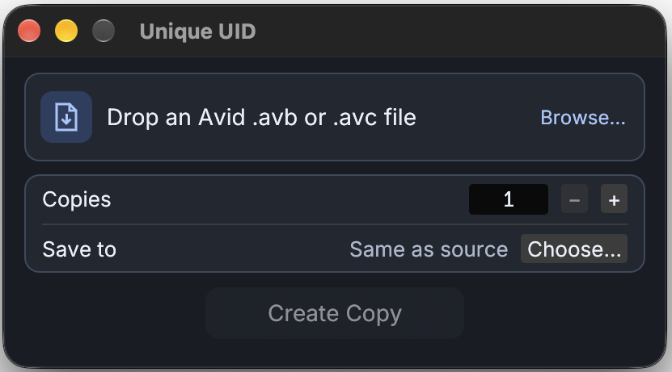

# Unique UID

A desktop utility for duplicating Avid Media Composer bins and scripts. Written in Rust.

[**Download Unique UID**](https://github.com/whatever-industries/unique-uid/releases/latest) for macOS 14 or newer (Apple Silicon or Intel), Windows (x64 or ARM64), or Linux (x64 or ARM64 AppImage).



> **Independent metadata is in beta.** Use a disposable bin first. Avid bins can contain specialized clips, effects, and linked records. The beta supports ordinary master clips, direct subclips, ordinary synced groups, and timelines with supported layouts. If a bin cannot be copied safely in this mode, choose a bin-only copy.

## Use case

Use Unique UID when you need to duplicate a bin or script for reuse in the same Avid Media Composer project. A regular file copy keeps the original UID even if you rename it, which can cause a UID collision when you open both files. Unique UID assigns each copy a fresh UID.

## Use

1. Drop one `.avb` or `.avc` file into the window, or click **Browse…**.
2. Set the copy count and choose an output folder. Copies save beside the source file by default.
3. For bins, leave **Independent metadata** checked to give each supported visible clip and timeline a fresh MobID. Uncheck it for a bin-only copy with shared item IDs.
4. Click **Create Copy** or **Create Copies**. If the bin contains a timeline, confirm that its source links will stay shared. Use **View UIDs** to see the assigned bin or script UIDs and open the output folder.

Every copy receives a random 64-bit document UID. The app skips existing filenames and writes each copy to a new file.

In **Independent metadata** mode, a copied clip has its own metadata and uses the existing media. A copied timeline keeps its original clip, group, and nested timeline links. If a bin contains both a timeline and one of its source clips, the visible clip duplicate has independent metadata while the copied timeline still uses the original clip.

In bin-only mode and when copying scripts, the app changes only the eight-byte document UID. Bin-only copies share clip and timeline metadata. Script copies can have their own script marks and keep their existing takes.

Supported layouts are AObjDoc container version 4, ABIN/BINF root versions 14 and 15, and Scpt root versions 2 and 3 with the version-1 rectangle. A side-by-side script test in Media Composer 25.12 verified that a changed mark stayed in the copy after saving and reopening, and the takes still loaded and scrubbed.

On Linux, drag-and-drop uses X11 or XWayland. On Wayland-only desktops, use **Browse…**. The Linux picker uses the XDG Desktop Portal or Zenity.

## Build and test

With Rust 1.92 or newer, run these from the project folder.

```sh
cargo test --locked
cargo run --locked
```

On Debian or Ubuntu, install the Wayland, XKB, and GL development packages first.

```sh
sudo apt-get install libwayland-dev libxkbcommon-dev libxkbcommon-x11-0 libgl1-mesa-dev libegl1-mesa-dev
```

On macOS, `./Scripts/build-app.sh` packages the app in `dist/`.

## Release

Update the version in `Cargo.toml` and `Cargo.lock`, update `RELEASE_NOTES.md`, and push a matching version tag. GitHub Actions tests and builds macOS ZIPs, Windows installers and Linux AppImages for both architectures, then publishes a release with a download table. Beta version tags publish as prereleases. Push a branch under `beta/` to build all six packages without publishing a release.

## License

[MIT](LICENSE). The bundled Inter font is licensed under the [SIL Open Font License](assets/Inter-OFL.txt). See [third-party notices](THIRD_PARTY_NOTICES.txt) for the Any NLE AVB library.
